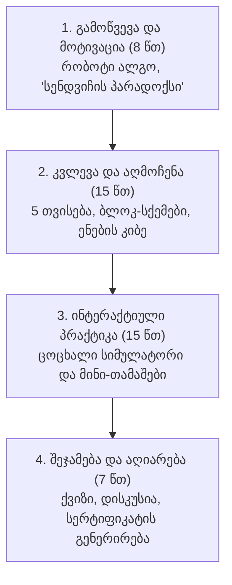

# მეთოდური გზამკვლევი და გაკვეთილის გეგმა: „რა არის ალგორითმი?“ (IV-VI კლასები)

**საგანი:** კომპიუტერული ტექნოლოგიები / ინფორმაციული და საკომუნიკაციო ტექნოლოგიები (ისტ)  
**სამიზნე აუდიტორია:** IV–VI კლასები (ასაკი: 9–12 წელი)  
**გაკვეთილის ხანგრძლივობა:** 45 წუთი (შესაძლებელია 2 აკადემიურ საათზე გაშლაც)  
**რესურსის ფორმატი:** ინტერაქტიული ვებ-აპლიკაცია (`index.html`), არ საჭიროებს ინსტალაციას, მუშაობს ნებისმიერ ბრაუზერში, კომპიუტერზე, პლანშეტსა და პროექტორზე ოფლაინ რეჟიმშიც.

---

## 1. ეროვნულ სასწავლო გეგმასთან (ესგ) შესაბამისობა და სტანდარტები

### სამიზნე ცნებები:
* **ალგორითმი და პროგრამული კოდი:** მოქმედებათა თანმიმდევრობა, ბრძანება, პირობა, ციკლი.
* **ინფორმაცია და მონაცემები:** შეტანა, დამუშავება, გამოტანა.
* **კომპიუტერული სისტემები:** როგორ „ფიქრობს“ კომპიუტერი, მანქანური და პროგრამირების ენები.

### ქვეცნებები / საკითხები:
* ალგორითმის არსი და ყოველდღიური მაგალითები;
* ალგორითმის 5 ძირითადი თვისება (სასრულობა, განსაზღვრულობა, უნივერსალურობა, შედეგიანობა, დისკრეტულობა);
* ალგორითმის წარმოდგენის 4 ფორმა (სიტყვიერი, ფსევდოკოდი, ბლოკ-სქემა, პროგრამირების ენა);
* 3 ძირითადი მმართველი სტრუქტურა (წრფივი, განშტოებადი, ციკლური) და რეკურსიის ინტუიციური გაგება;
* „ბაგის“ (შეცდომის) პოვნა და გასწორება (Debugging).

---

## 2. გაკვეთილის მიზნები და მოსალოდნელი შედეგები

| მიზანი (სწავლის შედეგი) | ინდიკატორი (მოსწავლე შეძლებს...) |
| :--- | :--- |
| **ალგორითმის არსის გაგება** | საკუთარი სიტყვებით ახსნას, რა არის ალგორითმი და მოიყვანოს მაგალითები რეალური ცხოვრებიდან (სენდვიჩის დამზადება, ქუჩაზე გადასვლა). |
| **თვისებების ამოცნობა** | დაასახელოს და მარტივი ენით განმარტოს ალგორითმის 5 თვისება. |
| **ბლოკ-სქემის კითხვა** | განასხვაოს გეომეტრიული ფიგურები: ოვალური (დასაწყისი/დასასრული), პარალელოგრამი (შეტანა/გამოტანა), მართკუთხედი (მოქმედება), რომბი (პირობა - IF). |
| **სტრუქტურების დიფერენცირება** | ერთმანეთისგან გაარჩიოს წრფივი, განშტოებადი და ციკლური ალგორითმები. |
| **პრაქტიკული გამოყენება & დებაგინგი** | ინტერაქტიულ სიმულატორში გატესტოს რიცხვები და დაალაგოს არეული ნაბიჯები სწორი თანმიმდევრობით. |

---

## 3. გაკვეთილის ეტაპობრივი გეგმა (45 წუთი)

### ეტაპი 1: გამოწვევა და მოტივაცია (8 წუთი)
1. **მასწავლებლის შესავალი (რობოტი ალგოს გაცნობა):**  
   მასწავლებელი ეკრანზე რთავს აპლიკაციის პირველ ჩანართს. მოსწავლეები ხედავენ მეგობრულ რობოტ ალგოს.
2. **ინტერაქტიული დისკუსია — „სენდვიჩის პარადოქსი“:**  
   მასწავლებელი ეკითხება კლასს: *„რა მოხდებოდა, ჯერ პურის მეორე ნაჭერი რომ დაგვეფარებინა და მერე წაგვესვა კარაქი?“*  
   მოსწავლეები ხვდებიან: **ნაბიჯების თანმიმდევრობას გადამწყვეტი მნიშვნელობა აქვს!**
3. **დონალდ კნუტის ციტატის გაცნობა:**  
   ბავშვებისთვის ადაპტირებული სახით გაეცნობიან 1968 წლის განმარტებას.

---

### ეტაპი 2: ახალი მასალის კვლევა და აღმოჩენა (15 წუთი)
1. **ალგორითმის 5 ჯადოსნური თვისება (მე-2 ბარათი):**
   * მოსწავლეები სათითაოდ აკლიკებენ თვისებების ბარათებს (სასრულობა, განსაზღვრულობა, უნივერსალურობა, შედეგიანობა, დისკრეტულობა).
   * განიხილავენ კითხვას: *„რა მოხდებოდა, ეს თვისება რომ არ ჰქონოდა ალგორითმს?“* (მაგ. სასრულობის გარეშე კომპიუტერი გაიჭედებოდა უსასრულო წრეზე).
2. **ჩაწერის 4 ფორმა და ბლოკ-სქემა:**
   * სიტყვიერი vs. ფსევდოკოდი.
   * ბლოკ-სქემის 7 ფიგურის დათვალიერება (ოვალური, პარალელოგრამი, მართკუთხედი, რომბი, ექვსკუთხედი, ქვეპროგრამა, დოკუმენტი).
3. **პროგრამირების ენების კიბე:**
   * ზედა დონე (Scratch, Python);
   * შუალედური (C, Java);
   * ქვედა/მანქანური (ასემბლერი და 0/1 ორობითი კოდი).

---

### ეტაპი 3: ინტერაქტიული პრაქტიკა და ლაბორატორია (15 წუთი)
1. **ცოცხალი სიმულატორი (ჩანართი 3):**
   * მოსწავლეები შეჰყავთ რიცხვები (A და B), აჭერენ ღილაკს **„გაშვება / ნაბიჯ-ნაბიჯ“** და აკვირდებიან, როგორ ანათებს ბლოკ-სქემის ბლოკები და როგორ ირჩევს ალგორითმი გზას რომბის პირობაში.
2. **მინი-თამაშები (ჩანართი 4):**
   * **თამაში 1 (ნაბიჯების დალაგება):** ისრებით (⬆️ ⬇️) ჩაის მომზადების, ქუჩაზე უსაფრთხოდ გადასვლისა და ჩანთის ჩალაგების ნაბიჯების სორტირება.
   * **თამაში 2 (ფიგურების ამოცნობა):** გეომეტრიული ფიგურის როლის ამოცნობა.

---

### ეტაპი 4: შეჯამება, შეფასება და აღიარება (7 წუთი)
1. **დიდი ალგორითმული ქვიზი:**
   * დიფერენცირებული მიდგომა: IV-V კლასელები ასრულებენ „დონე 1-ს (დამწყები)“, ხოლო დაწინაურებული / VI კლასელები — „დონე 2-ს (ექსპერტი)“.
2. **ზრდის მენტალიტეტი (Growth Mindset):**
   * მასწავლებელი ხაზს უსვამს: პროგრამირებაში შეცდომა (ბაგი) ჩვეულებრივი რამაა. ბაგის აღმოჩენა სწავლის საუკეთესო გზაა!
3. **სერტიფიკატის მიღება (ჩანართი 5):**
   * მოსწავლეები ავსებენ თავიანთ სახელს, იღებენ სიგელს **„ახალგაზრდა ალგორითმიკოსი“** და შეუძლიათ მისი დაბეჭდვა ან PDF-ად შენახვა.

---

## 4. შეფასების რუბრიკა (განმავითარებელი შეფასება)

| კრიტერიუმი | საწყისი დონე (გასაუმჯობესებელი) | საშუალო დონე (კარგი) | მაღალი დონე (ბრწყინვალე) |
| :--- | :--- | :--- | :--- |
| **ალგორითმის ცნება** | უჭირს ნაბიჯების დამოუკიდებლად დასახელება. | ასახელებს ნაბიჯებს, თუმცა უჭირს ზოგიერთი თვისების დაკავშირება. | ზუსტად განმარტავს ალგორითმს და ასაბუთებს მის 5-ვე თვისებას. |
| **ბლოკ-სქემის კითხვა** | ურევს ერთმანეთში ფიგურებს (მაგ. რომბსა და მართკუთხედს). | ცნობს ძირითად ფიგურებს (დასაწყისი, მოქმედება, პირობა). | უშეცდომოდ განმარტავს ყველა ფიგურას და ხსნის განშტოებას. |
| **ლოგიკური მსჯელობა და დებაგინგი** | უჭირს შეცდომის პოვნა არეულ ნაბიჯებში. | პოულობს შეცდომას მინიშნების დახმარებით. | სწრაფად ასწორებს არეულ ალგორითმს და ქმნის ალტერნატიულ გზას. |

---

## 5. საკლასო სამუშაო ფურცელი (Worksheet - დასაბეჭდად)

### სავარჯიშო 1: შეაერთე ისრებით
* **ოვალური ბლოკი** ➡️ `[ მოქმედების / გამოთვლის შესრულება ]`
* **რომბი** ➡️ `[ ალგორითმის დასაწყისი / დასასრული ]`
* **მართკუთხედი** ➡️ `[ მონაცემების შეტანა და გამოტანა ]`
* **პარალელოგრამი** ➡️ `[ პირობის შემოწმება (კი / არა) ]`

### სავარჯიშო 2: ლოგიკური ამოცანა
დაწერე ფსევდოკოდით ან სიტყვიერად:  
*„თუ გარეთ წვიმს, წავიღოთ ქოლგა, წინააღმდეგ შემთხვევაში წავიღოთ მზის სათვალე.“*  
რომელ ტიპს მიეკუთვნება ეს ალგორითმი (წრფივი, განშტოებადი თუ ციკლური)?  
**პასუხი:** __________________________________________________
